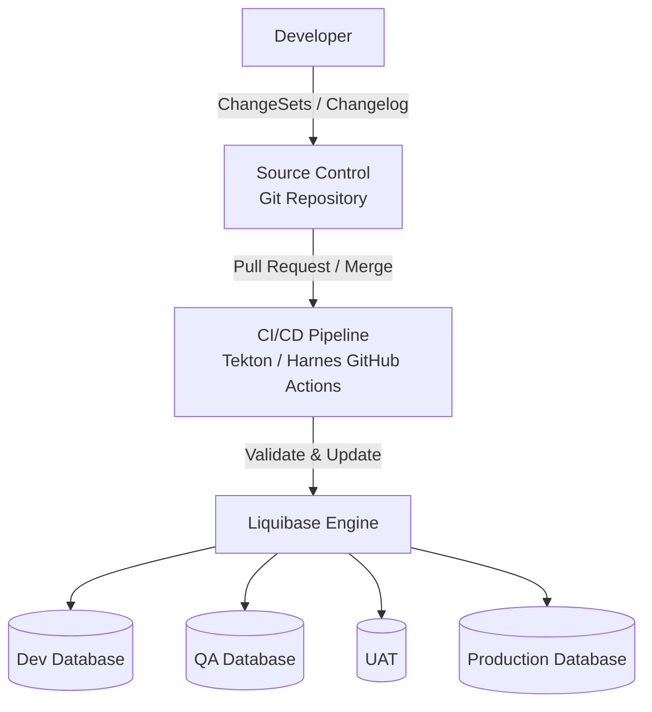
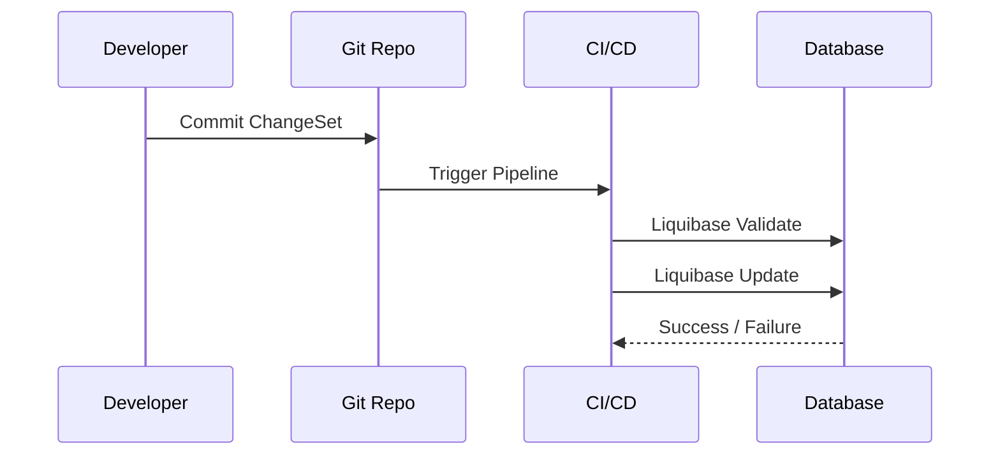
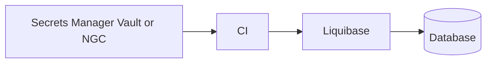

# database-migrations
Service Name: database-migrations
# Liquibase CI/CD Environment Architecture

This README provides a **presentation-ready, enterprise-grade explanation** of a best-practice Liquibase CI/CD architecture. You can **read directly from this file** during demos, reviews, or interviews.

---

## 📌 Purpose

The goal of this architecture is to:
- Manage database schema changes safely
- Ensure consistency across environments
- Eliminate manual database updates
- Enable automation, rollback, and auditing

Liquibase acts as the **database change engine**, while CI/CD pipelines control **when and where** changes are applied.

---

## 🏗️ High-Level Architecture Diagram



---

## 🧩 Core Components

### 1️⃣ Developer
- Writes database changes as **ChangeSets**
- No direct access to databases
- All changes go through Git

---

### 2️⃣ Source Control (Git)

Acts as the **single source of truth** for database changes.

Contains:
- `db.changelog-master.xml`
- Individual ChangeSet files
- Liquibase configuration

✅ Every DB change is:
- Versioned
- Reviewed
- Auditable

---

### 3️⃣ CI/CD Pipeline

The pipeline is the **orchestrator**.

Typical stages:
1. Checkout code
2. Liquibase validate
3. Liquibase update (dry run)
4. Liquibase update
5. Tests & approvals

📌 The pipeline decides **which environment** to deploy to.

---

### 4️⃣ Liquibase Engine

Liquibase is **stateless**.

What it does:
- Reads changelog files
- Checks `DATABASECHANGELOG` table
- Applies only pending ChangeSets
- Records execution history

Liquibase does **not** decide environments — databases do.

---

### 5️⃣ Target Environments

Each environment has:
- Same changelog
- Different configuration
- Independent execution history

| Environment | Purpose |
|------------|--------|
| Dev | Rapid development & testing |
| QA | Functional & integration testing |
| UAT | Business validation |
| Prod | Live production system |

---

## 🔄 Environment Promotion Flow



Same process repeats for **each environment**, ensuring predictability.

---

## ⚙️ Configuration Strategy (Best Practice)

```
liquibase/
 ├── changelog/
 │    └── db.changelog-master.xml
 ├── changesets/
 │    ├── 001-create-table.xml
 │    └── 002-add-index.xml
 └── config/
      ├── liquibase-dev.properties
      ├── liquibase-qa.properties
      ├── liquibase-uat.properties
      └── liquibase-prod.properties
```

✔ One changelog
✔ Multiple environment configs
✔ No credential hardcoding

---

## 🔐 Security Architecture



Best practices:
- Credentials stored in secret managers
- CI injects secrets at runtime
- Least-privilege DB users

---

## 🔁 Rollback Strategy

Every ChangeSet must support rollback.

Supported methods:
- ChangeSet rollback blocks
- Tag-based rollback
- Rollback to version

📌 Production rule:
> If rollback is not possible, deployment is blocked.

---

## 🚨 Failure Handling

If a deployment fails:
- ChangeSet is not recorded
- Transaction rolls back (if supported)
- Pipeline stops
- Database remains consistent

---

## ✅ Why This Architecture Works

| Challenge | Solution |
|--------|---------|
| Manual DB changes | Git-controlled ChangeSets |
| Environment drift | Same changelog everywhere |
| Deployment risk | CI validation & approvals |
| Auditing | DATABASECHANGELOG table |
| Concurrent runs | DATABASECHANGELOGLOCK |

---

## 🎤 One-Line Presentation Summary

> "Liquibase CI/CD architecture uses a single versioned changelog promoted through environments by pipelines, where each database independently tracks applied changes to ensure safe, consistent, and auditable deployments."

---

## 📎 When to Use This README

- Architecture walkthroughs
- Client presentations
- Design reviews
- Interview explanations
- Team onboarding

---

**End of Document**
